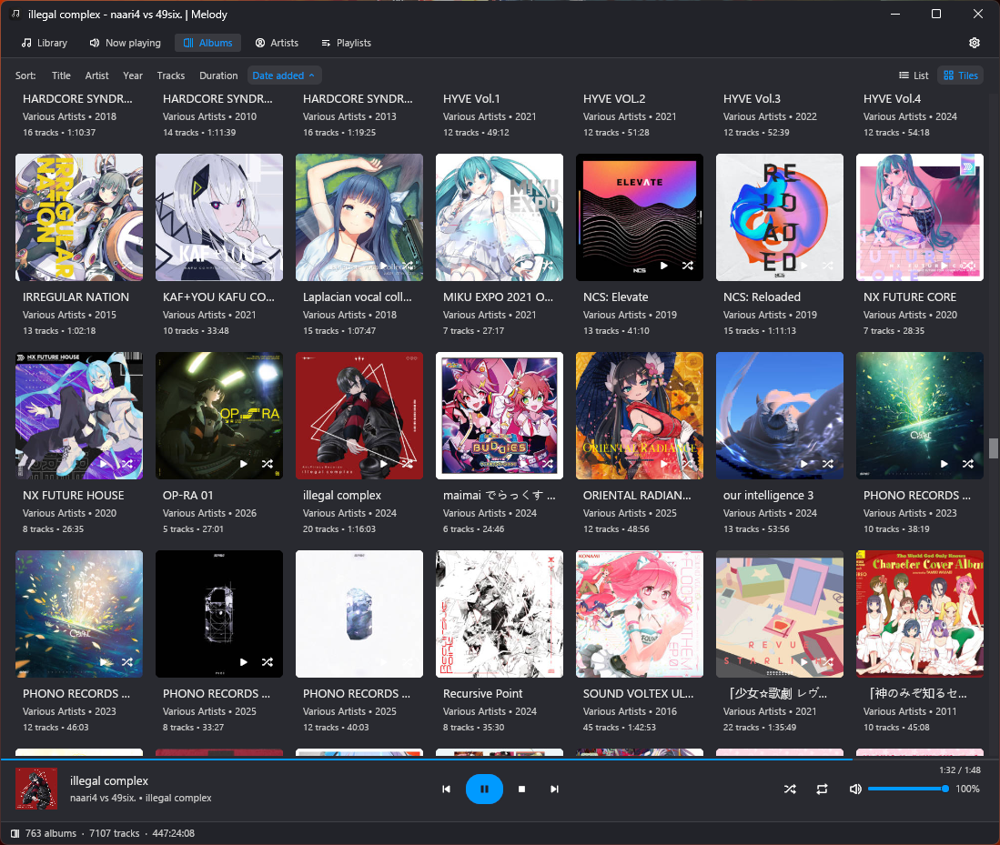
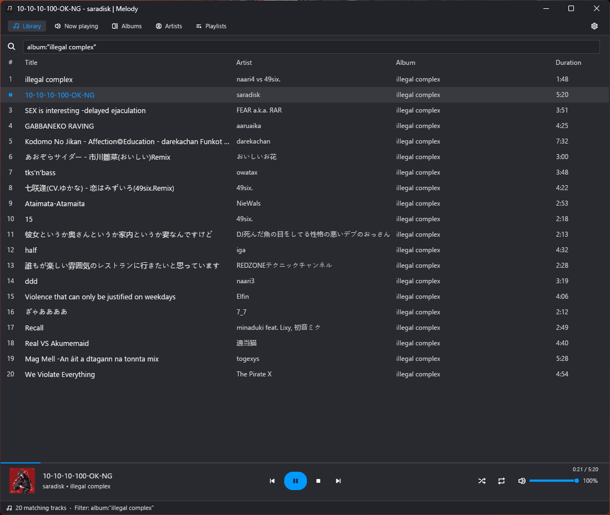
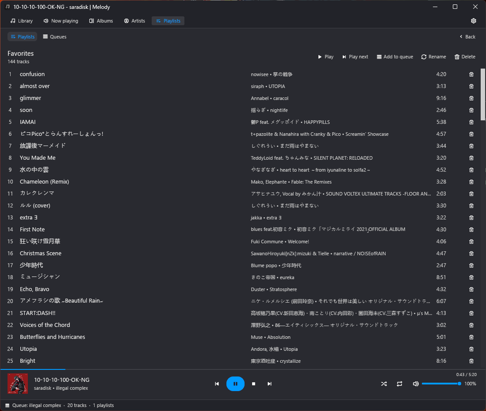
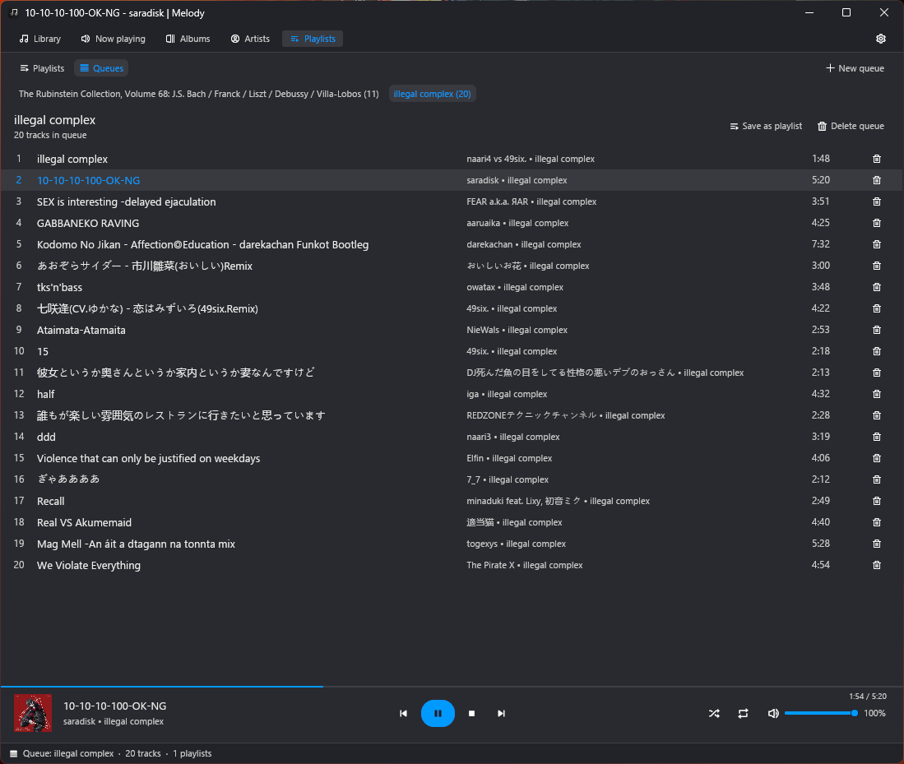

# Melody

Simple, modern, music player.

## Screenshots

| Albums View | Library View |
| :---: | :---: |
|  |  |
| **Playlists** | **Queues** |
|  |  |

## Features

- **Tracks (Library)**: Fast, virtualized track browser with customizable page sizes, configurable and sortable column headers, and scoped search (`artist:…`, `album:"…"`, `album_artist:…`, `genre:…`, `year:…`, `title:…` plus free text). Clicking an album or artist tiles into its exact scope.
- **Albums & Artists**: Aggregated catalog views with cover art, flexible grid/list layouts, configurable tile dimensions, and context menu options including "Play Next" and "Add to Queue". Album tiles carry play/shuffle actions; artist tiles are click-to-filter, with play/shuffle kept in list rows.
- **Playlists & Queues**: M3U/M3U8 playlists with import, rename, play next, and queue support. DB-backed playback queues (`playback_queues` / `playback_queue_tracks`) — every playback context (album, artist, search, playlist, all songs) becomes a named, reusable queue with a virtualized detail view.
- **Lyrics & Now Playing**: Dedicated player view showcasing artwork, track metadata, and scrollable lyrics with configurable cover sizes.
- **Player Bar**: Persistent bottom controls featuring live seek scrubbing, volume controls, shuffle, repeat, track favoriting, and now-playing details.
- **Status Bar**: Live catalog counts, active filter indicators, and library scanning progress.
- **Declarative KDL Layouts & View Formatting**: Fully data-driven layout engine defined in KDL files (`layouts/`). Define custom UI element positioning, dynamic library table columns, and view string templates with conditional syntax (e.g. `line2="{artist}[ • {year_label}]"`). See [String Formatting Documentation](docs/string-formatting.md).

## Developing

### Prerequisites

#### Linux (Nix / NixOS)

If you use Nix or Direnv, everything (FFmpeg, ALSA, Fontconfig, FreeType, Wayland, Vulkan) is packaged in `flake.nix`:

```bash
# Enter the nix dev environment
nix develop

# Or with direnv
direnv allow
```

#### Linux (Standard)

Ensure you have the development libraries for FFmpeg, ALSA, fontconfig, and pkg-config installed:

```bash
# Debian / Ubuntu
sudo apt install libavcodec-dev libavformat-dev libavutil-dev libswresample-dev libasound2-dev libfontconfig1-dev pkg-config
```

#### macOS / Windows

Standard Rust toolchain (`cargo`, `rustc`).

### Building & Running

Run the player:

```bash
cargo run
# or: cargo run -p ui --bin melody
```

Run tests across all crates:

```bash
cargo test --workspace
```

Build an optimized release binary:

```bash
cargo build --workspace --release
```

## License

Licensed under either of [MIT](LICENSE-MIT) or [Apache-2.0](LICENSE-APACHE) at your option.
