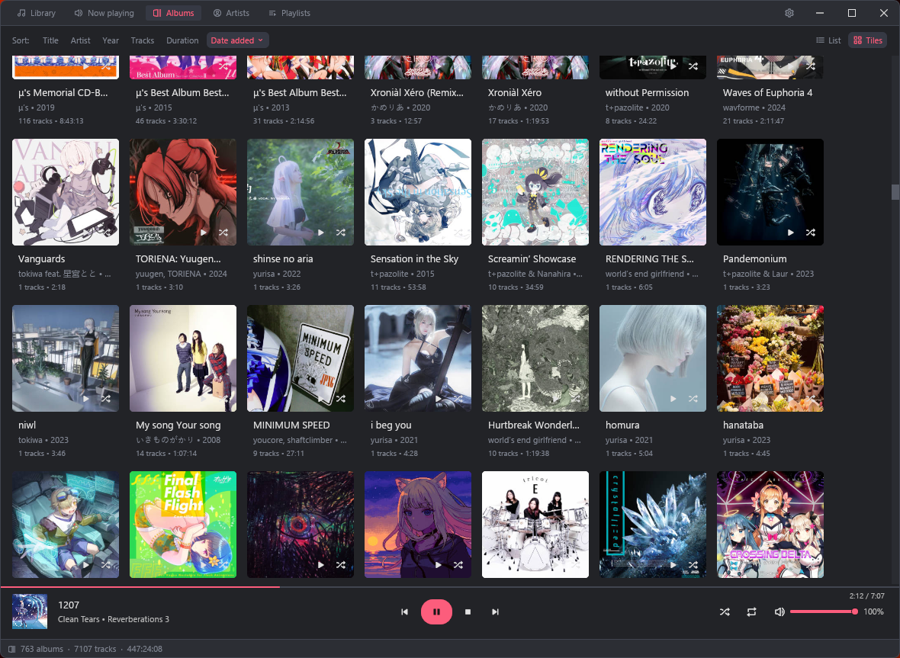
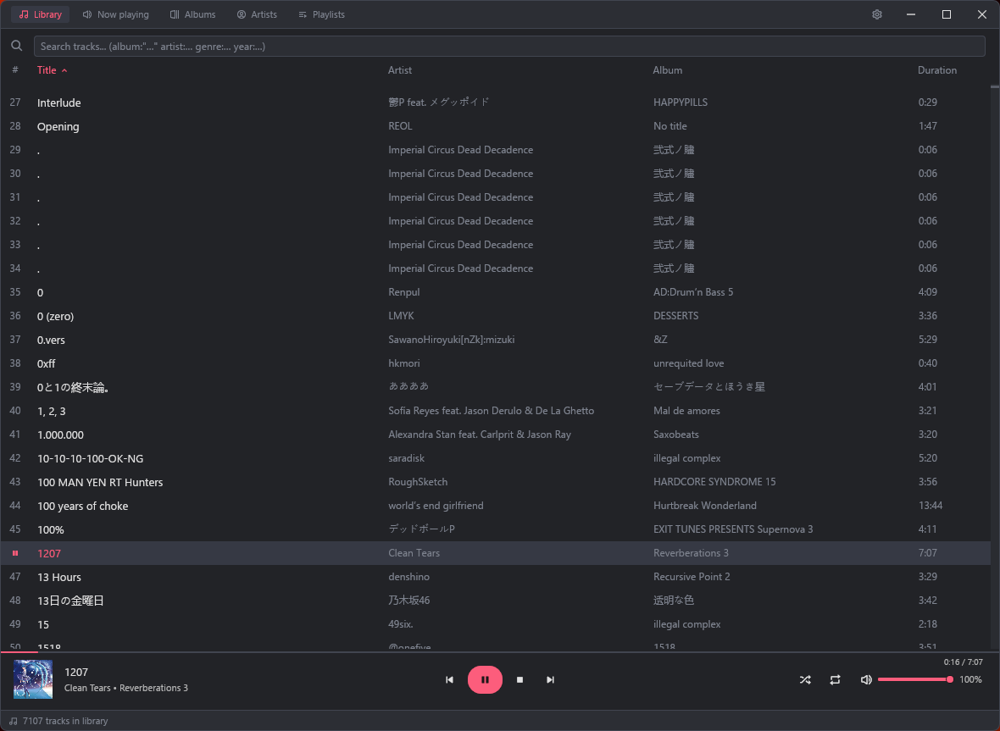
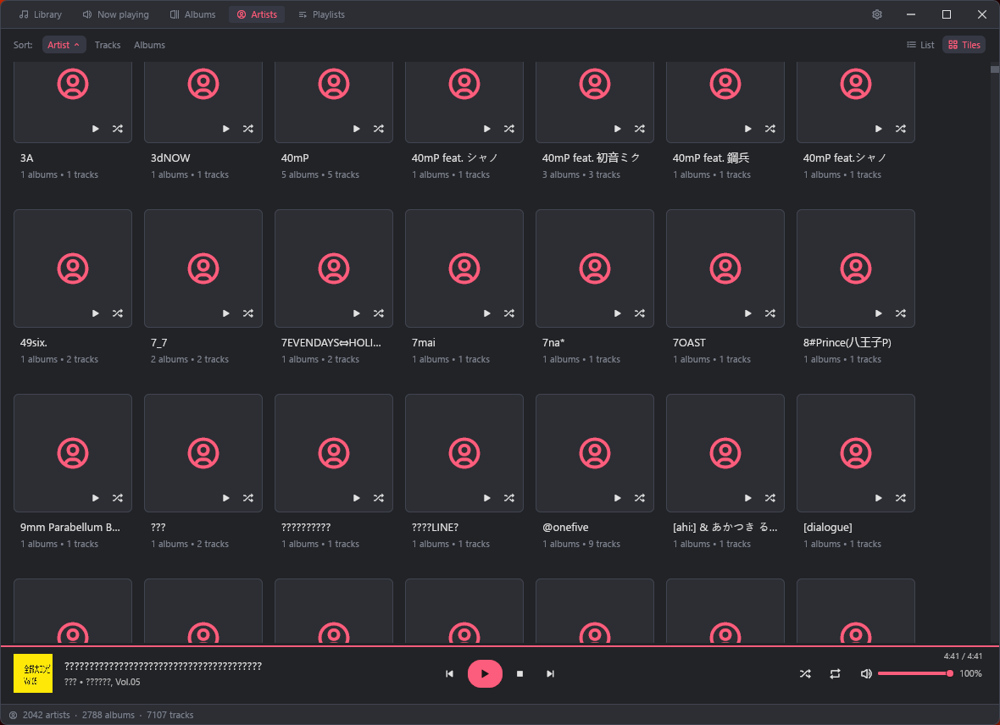
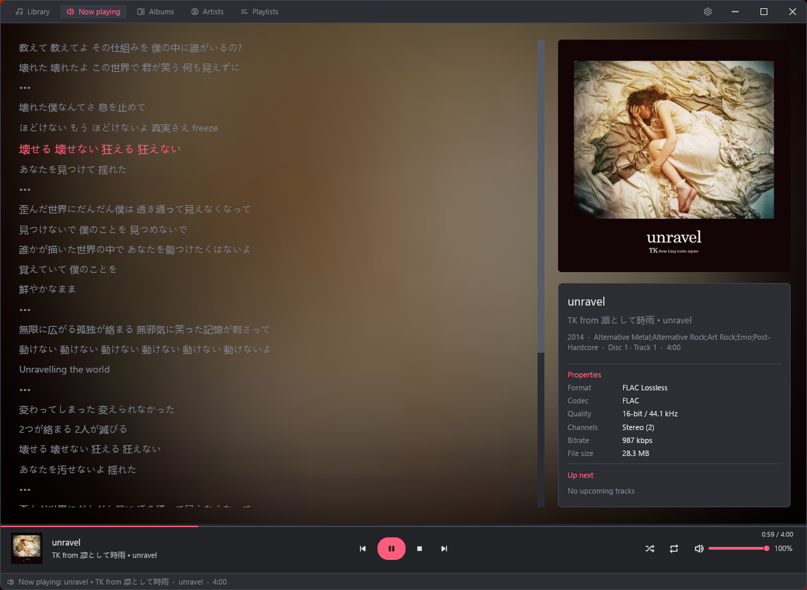
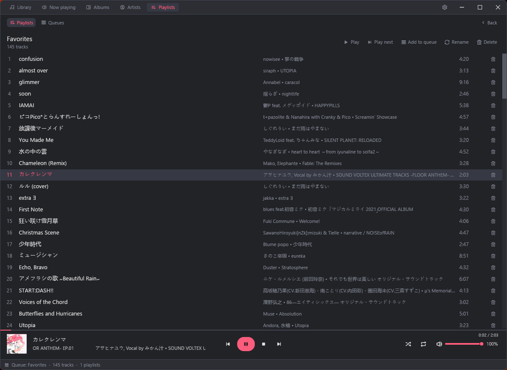
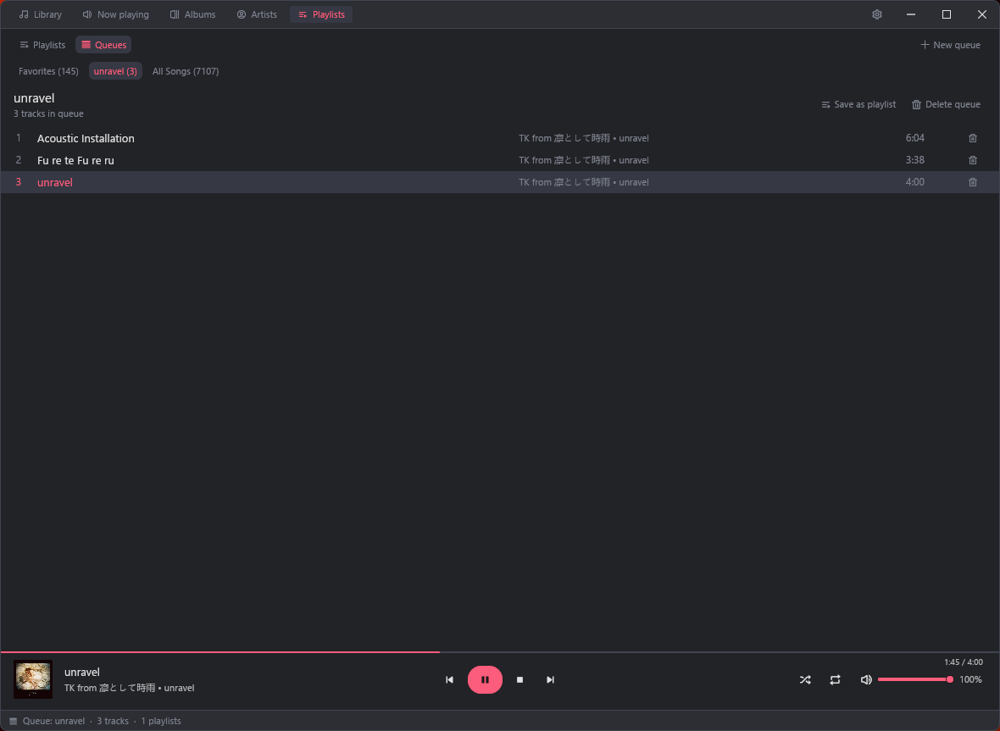

# Melody

Cross-platform music player, built with lightness and extensibility in mind.

## Features

1. Melody is built with musicolet-like queues; every track you play either creates a new queue or adds it to an existing one.
2. User customizable KDL layouts and themes. See references for layouts [here](./layouts), and themes [here](./themes).
3. Scrobbling to platforms like ListenBrainz and Last.fm.

## Screenshots

|                  Albums                  |                  Library                   |
| :--------------------------------------: | :----------------------------------------: |
|     |      |
|                 Artists                  |                Now Playing                 |
|    |  |
|                Playlists                 |                   Queues                   |
|  |       |

## Contributing

You are free to contribute as you see fit. However, please make sure you create or reference an issue before submitting a pull request.

## License

This project is licensed under the MIT License. See the [LICENSE](LICENSE) file for details.
